# TeamFlow

TeamFlow is a multi-tenant project management and team collaboration SaaS built with the MERN stack. Organizations manage projects, tasks, teammates, comments, and progress in separate workspaces. The repository includes the React application, REST API, MongoDB models, automated tests, and deployment configuration for Vercel, Render, and MongoDB Atlas.

## Features

- Responsive product landing page, login, registration, password recovery, and invitation acceptance.
- Organization workspaces with member invitations, role changes, removal, and per-workspace roles.
- Project creation, search, status filters, details, dates, members, and progress.
- Task assignment, status and priority, due dates, filtering, pagination, comments, activity history, and persistent Kanban drag-and-drop.
- Dashboard statistics, recent activity and deadlines, and Recharts analytics based on MongoDB data.
- User profile, organization settings, notifications, light/dark theme, loading, error, and empty states.
- Password recovery with an emailed reset link and one-time code, strong password rules, and server verified Cloudflare Turnstile CAPTCHA.
- Backend role checks and tenant-scoped database access, request validation, rate limiting, Helmet, CORS, and centralized errors.
- Short lived JWT access tokens and rotating, hashed refresh sessions in HTTP-only cookies. Password reset tokens are hashed and single use.

## Screenshots

These screenshots use a local demo workspace with fictional names and email addresses.

<p align="center">
  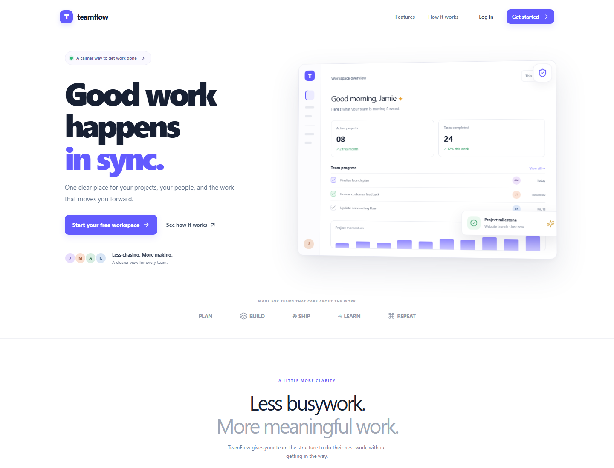
  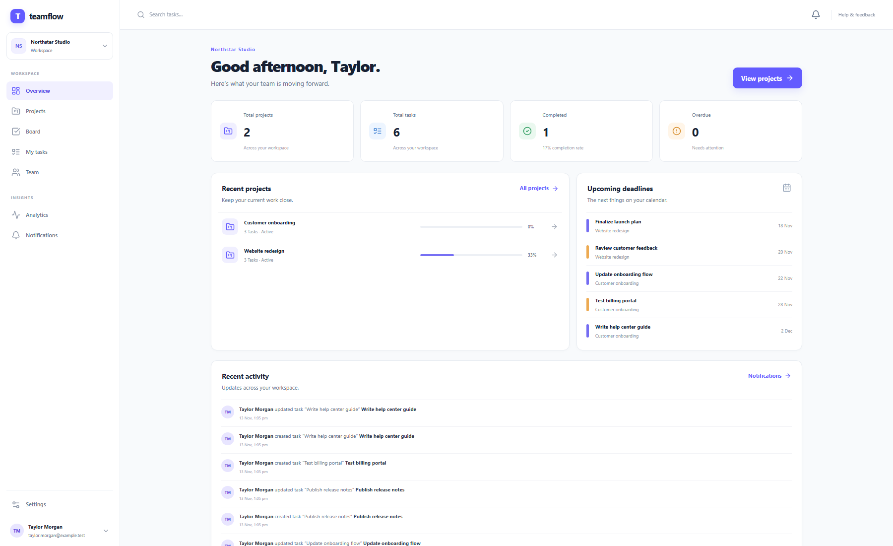
</p>
<p align="center">
  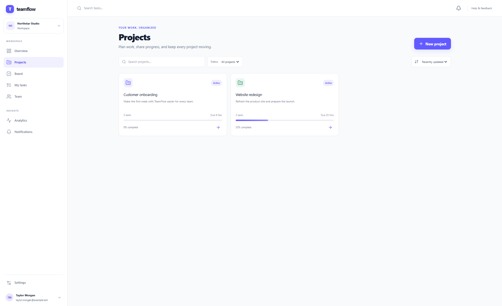
  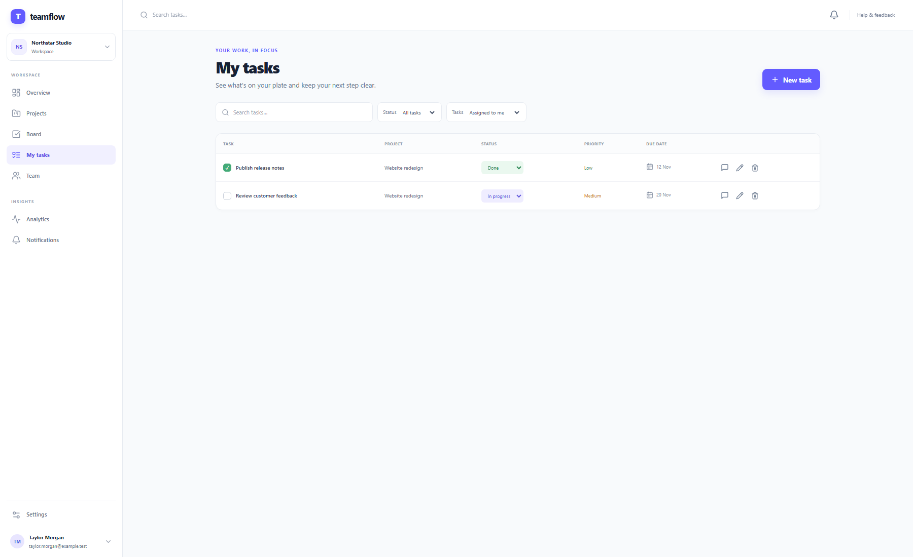
</p>
<p align="center">
  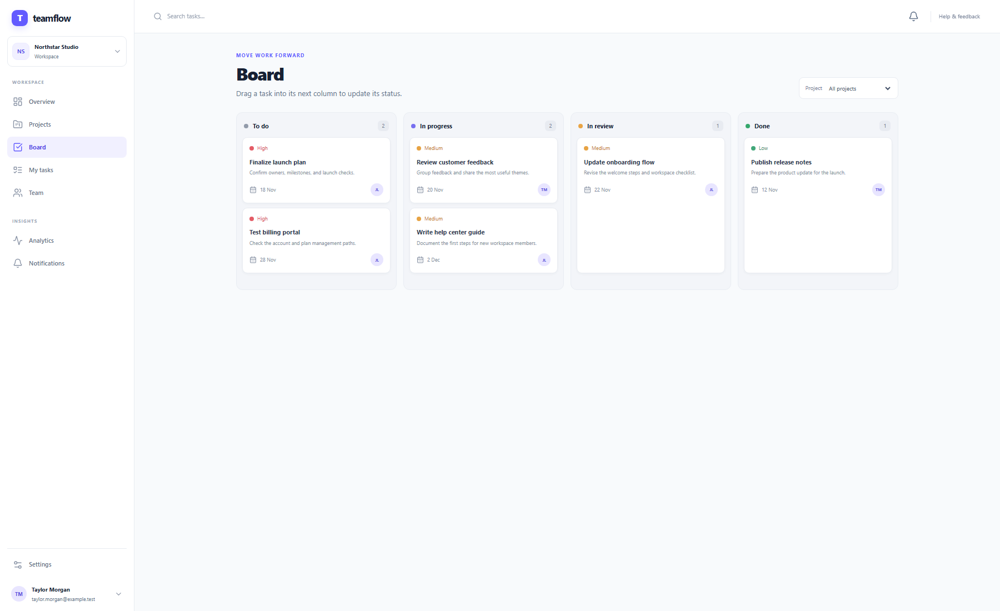
  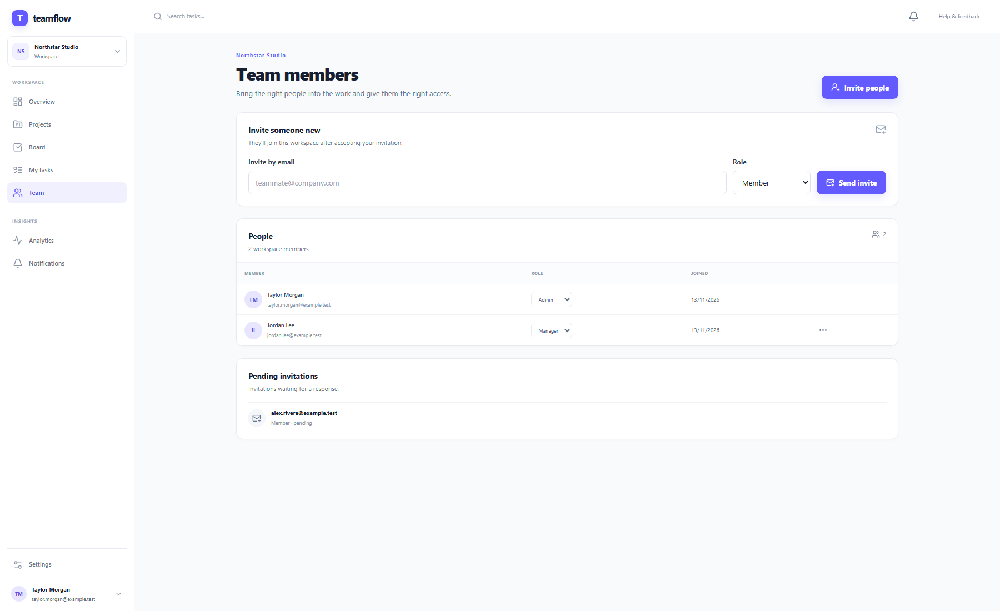
</p>
<p align="center">
  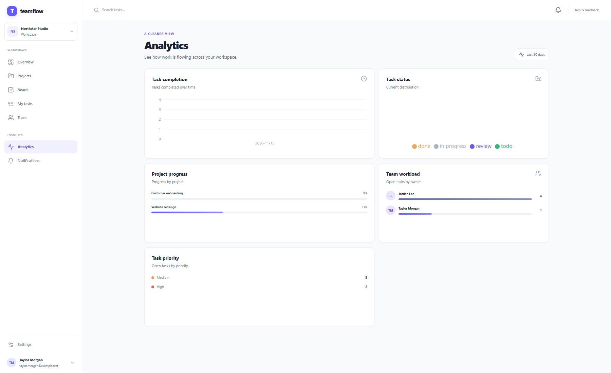
  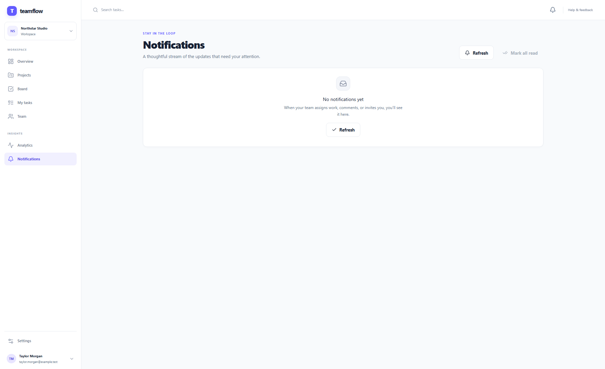
</p>
<p align="center">
  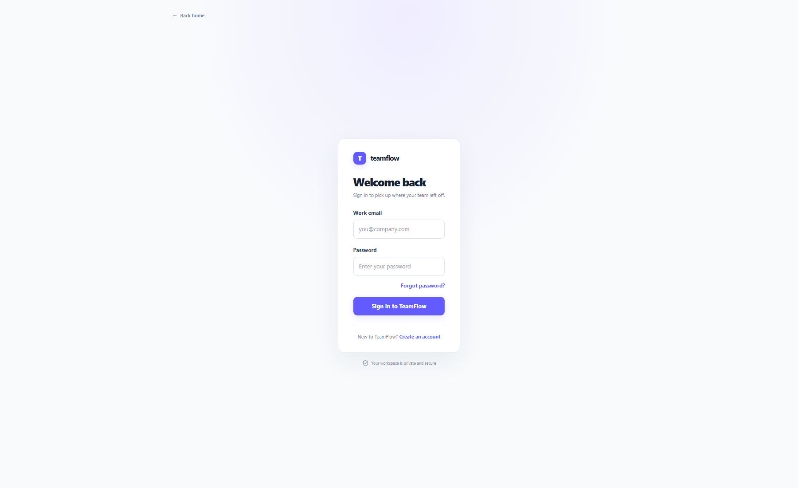
  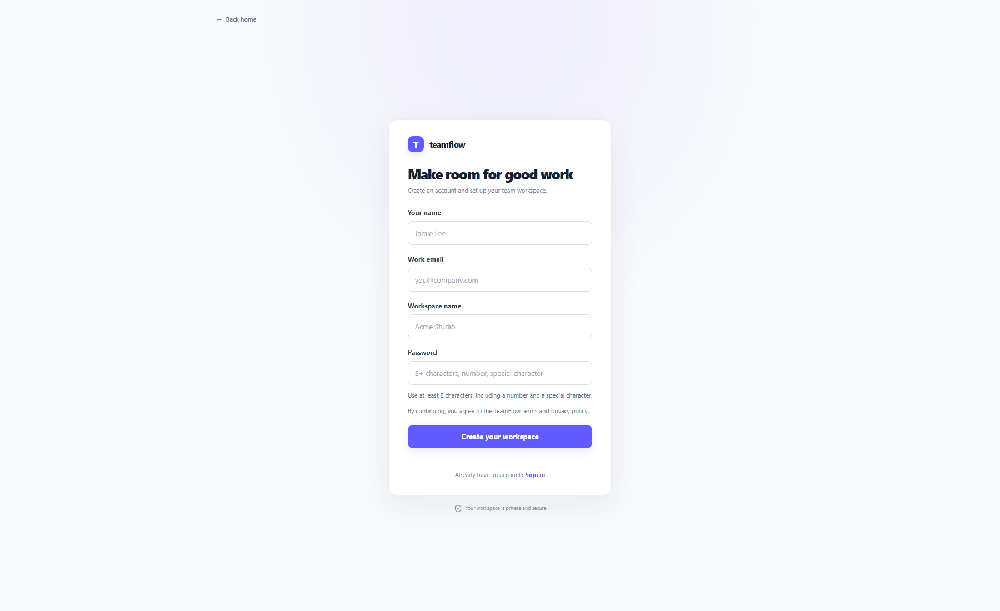
</p>

## Technology stack

| Area | Technology |
| --- | --- |
| Frontend | React 19, JavaScript, Vite, React Router, Context API, Axios |
| UI | CSS, Tailwind CSS, Lucide React, Recharts, dnd-kit |
| Backend | Node.js, Express 5, MVC routes/controllers/services |
| Data | MongoDB, Mongoose |
| Security | JWT, bcryptjs, HTTP-only cookies, Zod, Helmet, CORS, express-rate-limit |
| Tests | Jest, Supertest, Vitest, React Testing Library |
| Hosting target | Vercel (client), Render (API), MongoDB Atlas (database) |

## Architecture

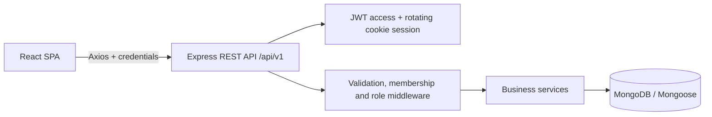

The client uses route layouts, reusable components, Context providers, and a shared Axios instance. The backend separates routes, controllers, services, models, validators, and middleware. Controllers translate HTTP requests into service calls; services hold business rules and tenant-aware queries. Zod validates request bodies and query parameters. API responses use `{ success, data, message? }`; errors use `{ success: false, message, code?, details? }`.

### Database relationships

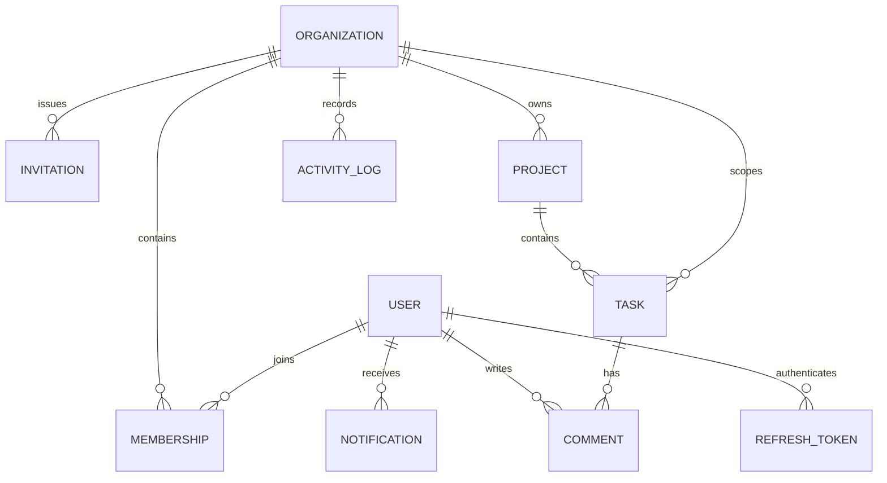

Organization-owned records carry an organization reference. Membership links users to organizations and stores the role for that workspace, so one user may have different roles in different organizations. Services first verify membership and then scope resource queries to the active organization. MongoDB schemas use timestamps and indexes for common lookup and uniqueness constraints.

For practical module explanations, data flows, common errors, and interview review questions, see [the learning guide](docs/LEARNING_GUIDE.md).

## Repository layout

```text
client/                 React application and client tests
  src/components/       Reusable controls and application layouts
  src/context/          Authentication and toast state
  src/pages/            Public, dashboard, project, task, team, and settings pages
  src/routes/           Protected and role-protected routes
  src/services/         Shared API client
server/                 Express API
  config/               MongoDB connection and production env validation
  controllers/          HTTP request/response handlers
  middleware/           Auth, membership, role, validation, and errors
  models/               Mongoose schemas
  routes/               Versioned REST endpoints
  services/             Auth, org, project, task, analytics, and collaboration logic
  tests/                Jest and Supertest API tests
docs/                   Learning guide and deployment notes
```

## Requirements and local setup

Use Node.js 20.19 or newer, npm, and a reachable MongoDB instance (local MongoDB or Atlas). From the repository root:

```powershell
npm install
Copy-Item server/.env.example server/.env
Copy-Item client/.env.example client/.env
```

Set `MONGODB_URI` in `server/.env` to your local or Atlas connection string. The example values are only for local development. For a shared or production environment, use unique random secrets and real email settings. Never commit `.env` files.

Run both applications together:

```powershell
npm run dev
```

The client is at `http://localhost:5173`; the API is at `http://localhost:5000`. Check `http://localhost:5000/api/v1/health` for API health.

Run one side independently:

```powershell
npm run dev:client
npm run dev:server
```

## Environment setup

`server/.env.example` documents API variables. Important settings:

| Variable | Purpose |
| --- | --- |
| `MONGODB_URI` | MongoDB connection string |
| `ACCESS_TOKEN_SECRET` | Secret used to sign access JWTs; use a random value of at least 32 characters in production |
| `ACCESS_TOKEN_TTL` | Access token lifetime, such as `15m` |
| `REFRESH_TOKEN_TTL_DAYS` | Refresh session lifetime |
| `COOKIE_NAME` | HTTP-only refresh cookie name |
| `COOKIE_SECURE`, `COOKIE_SAME_SITE` | Cookie transport policy; production requires `true` and `none` for separate Vercel/Render origins |
| `CORS_ORIGINS` | Comma-separated allowed client origins |
| `CLIENT_URL`, `PASSWORD_RESET_URL` | Public client URLs used in email links |
| `SMTP_HOST`, `SMTP_PORT`, `SMTP_SECURE`, `SMTP_USER`, `SMTP_PASSWORD`, `SMTP_FROM` | SMTP delivery for password reset and organization invitations |
| `TURNSTILE_SITE_KEY`, `TURNSTILE_SECRET_KEY` | Cloudflare Turnstile keys; production requires real keys and rejects test keys |

`client/.env.example` contains `VITE_API_URL` and the public `VITE_TURNSTILE_SITE_KEY`. Local API requests use Vite's `/api/v1` proxy so the app works from localhost and a private LAN address. Local defaults use Cloudflare's test keys. Set the matching real site key in Vercel for production; keep the secret only in Render's environment settings.

## Commands

```powershell
npm run dev             # client and API
npm run dev:client      # client only
npm run dev:server      # API only
npm run build           # optimized production client build
npm test                # API integration/security tests and client tests
```

The API tests require a running MongoDB configured through `MONGODB_URI`; they create and remove a uniquely named test database. The client tests run in jsdom.

## API reference

Base path: `/api/v1`. Protected calls use the short-lived `Authorization: Bearer <access-token>` token. Refresh calls use the HTTP-only cookie and browser credentials. List endpoints accept `page` (default 1) and `limit` (default 20, max 100). Most successful responses include `success: true` and `data`.

| Method | Path | Access / purpose |
| --- | --- | --- |
| GET | `/health` | Public service health |
| POST | `/auth/register` | Public registration; may accept an invitation token |
| POST | `/auth/login` | Public login |
| POST | `/auth/refresh` | Rotate refresh session cookie |
| POST | `/auth/logout` | Revoke current refresh session |
| GET, PATCH | `/auth/me` | Read or update current profile |
| POST | `/auth/forgot-password` | Request email containing reset link and one-time code |
| POST | `/auth/reset-password` | Verify link token, email code, strong password, and CAPTCHA |
| POST, GET | `/organizations` | Create an organization; list memberships |
| GET, PATCH | `/organizations/:id` | Read workspace; ADMIN updates workspace |
| GET | `/organizations/:id/members` | List workspace members |
| POST | `/organizations/:id/invitations` | ADMIN invites a member |
| POST | `/invitations/:token/accept` | Authenticated user accepts invitation |
| PATCH, DELETE | `/organizations/:id/members/:userId` | ADMIN changes role or removes member |
| POST, GET | `/projects` | ADMIN/MANAGER create; members list authorized projects |
| GET, PATCH, DELETE | `/projects/:id` | Read/update; ADMIN/MANAGER update, ADMIN deletes |
| POST, GET | `/tasks` | ADMIN/MANAGER create; list supports project, search, status, priority, assignee, and `mine` filters |
| GET, PATCH, DELETE | `/tasks/:id` | Read/update with service permission checks; ADMIN/MANAGER delete |
| POST, GET | `/tasks/:id/comments` | Add and list comments for an authorized task |
| GET | `/tasks/:id/activity` | Paginated task activity |
| GET | `/notifications` | List current user's notifications |
| PATCH | `/notifications/:id/read` | Mark own notification read |
| PATCH | `/notifications/read-all` | Mark all current user's notifications read |
| GET | `/analytics/overview` | Workspace overview for members |
| GET | `/analytics/tasks`, `/analytics/projects`, `/analytics/team` | ADMIN/MANAGER analytics |

Project list filters include `search`, `status`, and `sort`. Task states are `TODO`, `IN_PROGRESS`, `REVIEW`, `DONE`; priorities are `LOW`, `MEDIUM`, `HIGH`. See `server/validators/` for accepted request fields and validation rules.

## Deployment

Deployment descriptors are included in `render.yaml` (API) and `client/vercel.json` (SPA routing). Deploy the database first, then the API, then the client:

1. Create a MongoDB Atlas cluster and allow the Render service to connect. Use a dedicated database user and keep its URI private.
2. Create a Render web service from this repository using `render.yaml`. Add the production values for `MONGODB_URI`, `ACCESS_TOKEN_SECRET`, the SMTP settings, and the Vercel origins/URLs. Production startup rejects missing email settings, a short access secret, insecure cookies, or incompatible cross-site cookie settings.
3. Deploy `client/` to Vercel. Set `VITE_API_URL` to the Render API URL plus `/api/v1` and add the Vercel client origin to Render's `CORS_ORIGINS`.
4. Set `CLIENT_URL` and `PASSWORD_RESET_URL` to the deployed client origin and reset route. Set the matching real Turnstile site key in Vercel and secret key in Render. Verify that Render's `COOKIE_SECURE=true` and `COOKIE_SAME_SITE=none` are configured for cross-site HTTPS cookies.
5. Verify the deployed `/api/v1/health`, register and login, refresh and logout, password reset email delivery, invitation acceptance, and workspace isolation.

This repository is configured for deployment, but it has not been deployed: access to Atlas, Render, Vercel, SMTP credentials, and the public production URLs is not available in this workspace.

## Future improvements

- Add browser-based end-to-end tests and visual regression screenshots.
- Add OpenAPI generation, structured request logging, and monitored production error reporting.
- Add optional real-time collaboration after the polling-based notification flow is deployed and measured.
- Add organization billing, audit export, and data retention controls.

## Author

Built by the repository owner as a full-stack portfolio project.
